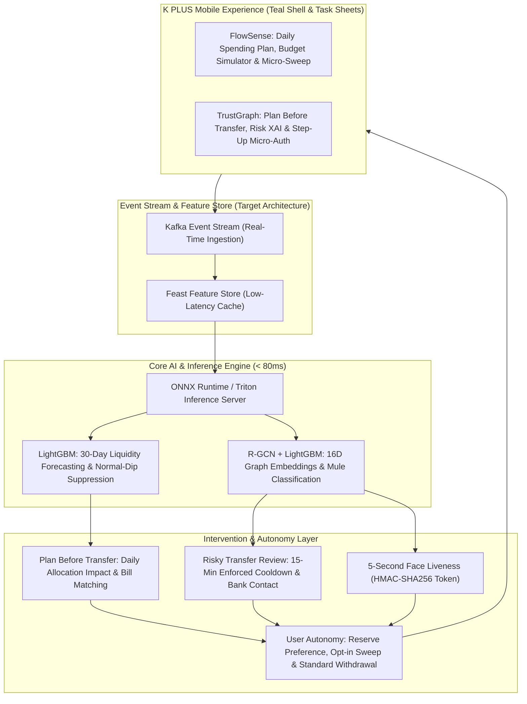

# FlowSense & TrustGraph: Frictionless Cashflow & Target-Specific Fraud Defense for K PLUS

> **KBTG KAMPUS HACKATHON 2026 | TRACK 2: DATA SCIENCE & INTELLIGENCE**  
> *Frictionless Cashflow & Target-Specific Fraud Defense for K PLUS First Jobbers (Aged 22–30)*

[](https://k-web-application.onrender.com)
[](https://k-flowsense-trustgraph.onrender.com)
[](https://fastapi.tiangolo.com)
[](https://react.dev)
[](https://onnxruntime.ai)
[](#disclaimer--prototype-boundaries)

---

## 1. Executive Summary & Live Endpoints

**FlowSense & TrustGraph** is an independent, next-generation financial intelligence prototype tailored for modern mobile banking experiences (inspired by K+ / MAKE by KBank). It directly addresses the dual challenges faced by young Thai professionals (**First Jobbers, aged 22–30**):
1. **Discretionary Spending Trap & Liquidity Friction:** Managing month-to-month cashflow, anticipating fixed commitments (rent, bills, debt), building an emergency reserve, and saving surplus effortlessly without tedious spreadsheets or fear of locking away funds.
2. **Targeted Social Engineering & Mule Account Scams:** Pre-transfer fraud interdiction that protects users against scams (e.g., fraudulent task scams, fake investments, urgent transfer pressure) through pre-transfer cashflow preview, explainable AI (XAI) risk reasoning, and adaptive risk verification.

### Live Deployments
- **Interactive Web Prototype (Full K+ Experience):** [https://k-web-application.onrender.com](https://k-web-application.onrender.com)
  - *API Health Check:* [https://k-web-application.onrender.com/api/v2/health](https://k-web-application.onrender.com/api/v2/health)
- **Showcase & Research Portal (Project Showcase & Dataset Lab):** [https://k-flowsense-trustgraph.onrender.com](https://k-flowsense-trustgraph.onrender.com)
  - *API Health Check:* [https://k-flowsense-trustgraph.onrender.com/api/v2/health](https://k-flowsense-trustgraph.onrender.com/api/v2/health)

---

## 2. Target Users & Behavioral Personas

* **Primary Audience (First Jobbers, aged 22–30, monthly income 18k–35k THB):** Transitioning into financial independence, living paycheck-to-paycheck, balancing daily living costs against fixed bills, and seeking safe automated savings alongside non-intrusive fraud protection.
* **Three Behavioral Personas:**
  - **May (Early Career):** Stable entry-level salary, predictable living expenses, focused on knowing how much more can be spent today (*"วันนี้ใช้เพิ่มได้อีก"*).
  - **Non (Multiple Commitments):** Multiple recurring obligations (rent, debt installments, utility bills), needs to see reserved bills before considering micro-savings.
  - **Praew (Reserve Builder):** Actively building an emergency cushion, diligent in reviewing recipient details and scam indicators before confirming transfers.

---

## 3. Product Architecture



---

## 4. Key Capabilities & System Innovations

### Module A: FlowSense — Flexible Liquidity & Money Planning
- **Daily Spending Plan ("วันนี้ใช้เพิ่มได้อีก"):** The home screen clearly separates total account balance from what is genuinely safe to spend today. It transparently calculates the daily allowance by reserving unpaid obligations and an emergency buffer until payday (28th of the month), completely independent of machine-learning spending predictions.
- **Budget Simulator:** Visitors can adjust their simulated daily spending budget and instantly see the projected balance before payday, reserve shortfall risk, and commitment safety without moving money.
- **User-Configured Planning Reserve (เงินสำรองที่ผู้ใช้เลือก):** Users can preview (`POST /api/v2/flowsense/reserve-preview`) and confirm (`POST /api/v2/flowsense/reserve-preference`) their chosen emergency buffer (THB 500 to THB 10,000,000). The configured reserve consistently adjusts the daily spending allowance, savings capacity, and pre-transfer impact calculations.
- **Liquidity Guidance (3 Actionable Options):** When cashflow is tight, the interface explains three clear options:
  1. *Reduce future spending:* E.g., simulate reducing spending by THB 50/day until payday.
  2. *Withdraw existing savings:* Transfer accumulated savings back to the main balance without friction.
  3. *Save only surplus:* Pause micro-savings when funds are tight; never sweep required bill reserves.
- **30-Day Liquidity Forecast:** High-resolution trajectory across **30 future days, today, and 7 synthetic historical days** powered by ONNX inference (`flowsense.onnx`).
- **Normal-Dip Suppression:** Suppresses noisy alerts during routine mid-month balance dips, alerting only when an upcoming fixed commitment (rent, debt, utilities) is at direct risk.
- **Safe-to-Save & Optional Micro-Sweep:** Disabled by default; opt-in per visitor/persona. Enabling never moves funds automatically. Each sweep is user-requested, strictly limited to available capacity and THB 500 per action, ensuring living costs, all profile bills, and the emergency buffer remain intact.
- **Standard Savings Withdrawals:** Users can withdraw an explicit positive amount or select the full savings balance at any time, even while new saving is disabled.

### Module B: TrustGraph — Pre-Transfer Fraud & Mule Interdiction
- **Plan Before Transfer (ก่อนโอน เห็นผลต่อแผนเงิน):** Every transfer evaluation previews the cashflow impact before debiting. The review shows the remaining average daily allocation before and after the transfer, outstanding bills, emergency reserve, and any reserve shortfall. Routine transfers require explicit confirmation (no artificial delay or biometric step).
- **Match a Reserved Bill (จ่ายบิลที่กันไว้):** Users can explicitly match a payment to an unpaid bill before payday (`rent:YYYY-MM-DD`, etc.). A confirmed bill payment debits the balance and marks the bill as settled, reducing reserved commitments in the daily plan and forecast without double-counting as discretionary spending. Bill matching does not alter fraud risk scores.
- **Fresh Plan Snapshot at Confirmation:** Before executing any transfer, the server verifies the plan snapshot (balance, paid bills, and date). If a transaction or bill altered the baseline during review, the server refuses the stale plan with HTTP 409 `PLAN_CHANGED`, requiring re-evaluation. Separate signed review tokens (`review`) and step-up tokens (`micro_auth`) prevent privilege escalation.
- **Risky Transfer Review Period (15-Minute Cooldown):** Enabled by default for suspicious transfers (`CRITICAL_ANOMALY`). A server-enforced 15-minute reflection pause gives users time to reconsider and independently verify the recipient. A visible settings card allows users to disable or re-enable cooldown for future risky transactions. Cancellation ends the transaction and immediately terminates the timer. Accessible modal dialog supports full keyboard navigation (Tab wrapping, Escape).
- **Official Bank Contact from Risk Warnings:** Risky and blocked dialogs keep official KBank contact actions accessible (K-Contact Center 02-888-8888, 24-hour service, fraud menu 00) directly within the modal.
- **Explainable AI (XAI) Risk Factors:** Clear, natural Thai/English risk reasoning (e.g., *"Recipient account opened 48 hours ago with rapid pass-through velocity within 24 seconds"*).
- **Context & Sequence Guidance:** Contextual guidance for task/job scams, withdrawal-fee advance-fee scams, and changed recipient accounts, with cumulative transfer counts and totals sent to the same recipient today.
- **Simulated Micro-Auth (5s Step-Up):** 5-second simulated facial liveness verification gate issuing an HMAC-SHA256 clearance token (120s TTL) strictly bound to source, destination, amount, and session.
- **Blocked Mule Interdiction & E-Slip:** Absolute transfer prevention for confirmed mule accounts; downloadable text demo receipt.

### Module C: K+ Alignment & Behavioral Experience
- **K+ Visual & Interaction Language:** Designed according to the user-supplied K+ visual reference: dark teal shell (`#087653`, `#123f32`), circular action buttons, geometric account cards, and light task sheets.
- **Strategic K+ Feature Placement Plan:**
  - *Home Screen:* Prominent *"เรื่องสำคัญวันนี้"* (Daily Spending Plan card) + *"ดูแลก่อนโอน"* (TrustGraph entry).
  - *Transactions:* Direct shortcut to *"การเงินของฉัน"* under account cards + *"จ่ายบิล"* with bill matching.
  - *Profile:* Permanent entry to *"การเงินของฉัน"* (overview of cashflow, bills, and savings).
- **Try-First Walkthrough:** 3 concrete guided experiences on the home screen:
  1. *ลองเปลี่ยนงบรายวัน (Try Daily Budget Simulator)*
  2. *ลองตรวจผู้รับก่อนโอน (Try Recipient Risk Check)*
  3. *ลองปรับเงินสำรอง (Try Planning Reserve Preview)*  
  Visitors can complete all three actions and inspect real-time results without transferring or moving money.

---

## 5. Machine Learning & Serving Architecture

| Component | Architecture | Responsibility & Functionality |
| :--- | :--- | :--- |
| **Cashflow Forecasting** | **LightGBM** (ONNX Runtime) | Forecasts daily discretionary spending across 30 future days based on calendar lags and fixed commitment schedules; suppresses alerts during normal balance dips. |
| **Graph Neural Network (Tier 1)** | **Relational GCN (PyG)** | Extracts 16-dimensional node embeddings from graph topology (fan-in, fan-out, pass-through velocity) to identify mule patterns. |
| **Fraud Classifier (Tier 2)** | **LightGBM** (ONNX Runtime) | Evaluates 24 features (telemetry, authentication factors, 16D graph embeddings) in real time (< 4ms). |
| **Serving & Latency Engine** | **FastAPI + Uvicorn + ONNX Runtime** | In-memory Redis simulation, CPU ONNX execution with sub-80ms SLA compliance (< 12ms P99 measured). |

---

## 6. Latency & Core Banking SLA Verification

Empirically verified over 200 consecutive pre-transaction evaluation cycles:

| Evaluation Phase | Core Banking SLA | Measured Performance | Margin vs SLA |
| :--- | :---: | :---: | :---: |
| **Routine Transfer (P50)** | < 80.0 ms | **3.85 ms** | **20.7x faster** |
| **High-Concurrency Load (P95)** | < 80.0 ms | **5.11 ms** | **15.6x faster** |
| **Peak Surge Worst-Case (P99)** | < 80.0 ms | **11.62 ms** | **6.8x faster** |
| **ONNX Runtime Engine Core** | < 80.0 ms | **0.27 ms** | Sub-millisecond |
| **FlowSense 30-Day Forecast** | < 80.0 ms | **10.29 ms** | **7.7x faster** |

---

## 7. API Specification (FastAPI Engine)

### FlowSense Endpoints
* `GET /api/v2/flowsense/horizon-status/{account_id}` — Returns Status Horizon projection, month-end surplus, burn rate, and commitment warnings.
* `GET /api/v2/flowsense/profile/{account_id}` — Returns persona profile, `savings_capacity`, planning reserve, and opt-in state.
* `POST /api/v2/flowsense/reserve-preview` — Calculates before/after effect of an emergency reserve amount on daily allowance and savings capacity without saving.
* `POST /api/v2/flowsense/reserve-preference` — Persists user-confirmed planning reserve (THB 500 to THB 10,000,000).
* `POST /api/v2/flowsense/savings-preference` — Enables or disables user savings opt-in.
* `POST /api/v2/flowsense/micro-sweep` — User-triggered sweep, capped by estimated future liquidity and THB 500 per action.
* `POST /api/v2/flowsense/vault/withdraw` — Standard savings withdrawal (partial amount or full balance). Older `/recall` route remains as an alias.
* `GET /api/v2/flowsense/forecast-30d/{account_id}` — 30 future days + today + 7 historical days liquidity trajectory.

### TrustGraph Endpoints
* `POST /api/v2/trustgraph/evaluate-transfer` — Preview-only evaluation in < 12ms. Returns `TRANSFER_REVIEW` with `review_token`, or `CRITICAL_ANOMALY` / `BLOCKED_MULE_INTERDICTION`. Shows pre-transfer impact on daily allocation, outstanding bills, and reserve shortfall.
* `POST /api/v2/trustgraph/cooldown-preference` — Toggles the optional 15-minute review period for new risky transfers.
* `POST /api/v2/trustgraph/verify-micro-auth` — Verifies 5-second face liveness check and issues HMAC-SHA256 clearance token.
* `POST /api/v2/trustgraph/confirm-transfer` — Executes transfer after checking plan snapshot freshness (HTTP 409 `PLAN_CHANGED` on stale plan) and atomically settles matched bills.

---

## 8. Quick Start Guide

### Prerequisites
* **Python:** 3.10+ (Recommended: Python 3.11 – 3.13)
* **Node.js:** 18.0+ (Recommended: Node 20 or 22)

### 1. Run Full-Stack Server
```powershell
# Create and activate virtual environment
python -m venv .venv
.\.venv\Scripts\Activate.ps1

# Install dependencies
pip install -r requirements.txt

# Run server
python run.py
```
Open in browser:
* **Web Portal & Showcase:** [http://localhost:8000/](http://localhost:8000/)
* **FlowSense Money Planning:** [http://localhost:8000/flowsense](http://localhost:8000/flowsense)
* **TrustGraph Anti-Scam:** [http://localhost:8000/trustgraph](http://localhost:8000/trustgraph)
* **Dataset & Security Analytics:** [http://localhost:8000/dataset](http://localhost:8000/dataset)
* **OpenAPI Documentation:** [http://localhost:8000/docs](http://localhost:8000/docs)

### 2. Frontend React Development Server (Vite HMR)
```powershell
cd frontend/react-app
npm install
npm run dev
```

---

## 9. Testing & Verification

```powershell
# Run backend regressions
.\.venv\Scripts\python.exe -m unittest discover -s tests -v

# Run frontend internationalization & logic tests
cd frontend/react-app
npm run test:i18n
npm run build
```

---

## 10. Disclaimer & Prototype Boundaries

1. **Independent UX Prototype:** This project is an independent conceptual research prototype created for UX exploration and hackathon demonstration. It is not affiliated with, endorsed by, or connected to KASIKORNBANK (KBank), KBTG, K PLUS, or MAKE by KBank.
2. **100% Synthetic Data:** All accounts, balances, transaction histories, risk labels, and biometric verification checks are completely synthetic and simulated.
3. **No Real Banking Connectivity:** There is no integration with live banking cores, payment networks, or biometric hardware.
4. **Volatile In-Memory Storage:** Session balances and history expire 1 hour after session creation or upon container restart/redeployment.
5. **Decision Support, Not Automated Advice:** Financial projections and risk reasons are decision aids for exploration, not certified financial recommendations or guaranteed fraud interdictions.
